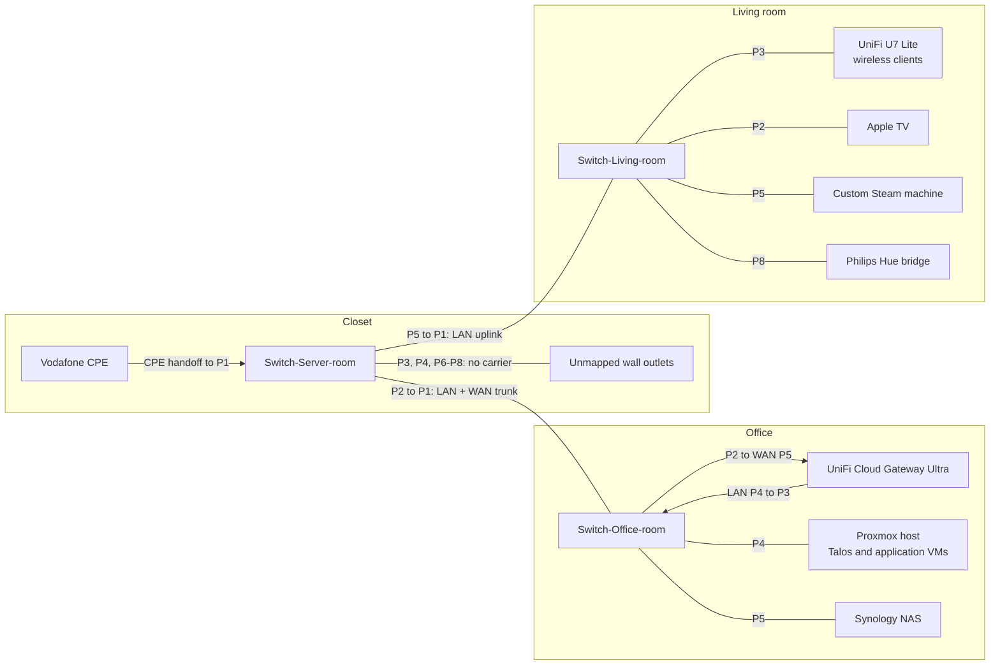

# Home network

## Equipment

| Device | Location | Model | Management address | Firmware |
| --- | --- | --- | --- | --- |
| Provider CPE | Closet | Vodafone equipment | — | — |
| Cloud Gateway Ultra | Office | UniFi Cloud Gateway Ultra | `10.77.77.1` | UniFi OS `6.0.17` |
| Switch-Server-room | Closet | TP-Link TL-SG108E v6.0 | `10.77.77.165` | `1.0.0 Build 20250710 Rel.71093` |
| Switch-Office-room | Office | TP-Link TL-SG108E v6.0 | `10.77.77.198` | `1.0.0 Build 20250710 Rel.71093` |
| Switch-Living-room | Living room | TP-Link TL-SG108E v6.0 | `10.77.77.124` | `1.0.0 Build 20250710 Rel.71093` |
| Wireless AP | Living room | UniFi U7 Lite | UniFi controller | — |

Switch management: static IPv4, mask `255.255.255.0`, gateway `10.77.77.1`,
DHCP client disabled. Matching DHCP reservations remain in UniFi.

Credentials: 1Password. Configuration backups: private recovery storage.

## Physical topology

## VLANs and addressing

| Role | VLAN on the switches | Subnet / address source | Gateway | DHCP |
| --- | --- | --- | --- | --- |
| Default LAN, management | 1, untagged at endpoints | `10.77.77.0/24` | `10.77.77.1` | UniFi: `.6`-`.254` |
| IoT | 2 | `10.77.80.0/24` | `10.77.80.1` | UniFi: `.6`-`.254` |
| Game Servers | 4 | `10.77.82.0/24` | `10.77.82.1` | UniFi: `.6`-`.254` |
| WAN transport | 10 | Provider DHCP | Provider handoff | UniFi WAN only |

Remote access: WireGuard `10.77.78.0/24`, One-Click VPN `10.77.79.0/24`.
These address spaces are separate from the Ethernet VLANs.

The server/office trunk carries VLAN 1 untagged and VLAN 10 tagged. Office P2
hands WAN traffic to gateway P5 untagged; WAN VLAN tagging is disabled in UniFi.
WAN IPv4 and DNS use provider DHCP. Gateway LAN P4 returns Default LAN to office P3.

```mermaid
flowchart LR
  CPE["Provider handoff"] --> CA["Server P1<br/>untagged VLAN 10"]
  CA --> TW["Server P2 / Office P1<br/>tagged VLAN 10"]
  TW --> OA["Office P2<br/>untagged VLAN 10"]
  OA --> WAN["Gateway WAN P5<br/>DHCP, no VLAN tag"]
  WAN --> ROUTER["Gateway routing / firewall"]
  ROUTER --> LAN["Gateway LAN P4<br/>Default LAN"]
  LAN --> OL["Office P3<br/>untagged VLAN 1"]
  OL --> TL["Office P1 / Server P2<br/>untagged VLAN 1"]
  TL --> SL["Server P5 / Living P1<br/>untagged VLAN 1"]
```

## Port configuration

- **U:** untagged VLANs; **T:** tagged VLANs; **PVID:** VLAN for incoming untagged frames.
- All ports enabled, auto-negotiation on, flow control off.
- Loop Prevention and configuration auto-save enabled on all switches.
- Link states/speeds are a snapshot. Unmapped wall outlets have no active link.

### Switch-Server-room

| Port | Connection | U | T | PVID | Link |
| --- | --- | --- | --- | --- | --- |
| P1 | Provider CPE handoff | 10 | — | 10 | 1 Gb/s full duplex |
| P2 | Office switch P1 | 1 | 10 | 1 | 1 Gb/s full duplex |
| P3 | Unmapped wall outlet | 1 | — | 1 | Down |
| P4 | Unmapped wall outlet | 1 | — | 1 | Down |
| P5 | Living-room switch P1 | 1 | — | 1 | 1 Gb/s full duplex |
| P6 | Unmapped wall outlet | 1 | — | 1 | Down |
| P7 | Unmapped wall outlet | 1 | — | 1 | Down |
| P8 | Unmapped wall outlet | 1 | — | 1 | Down |

### Switch-Office-room

| Port | Connection | U | T | PVID | Link |
| --- | --- | --- | --- | --- | --- |
| P1 | Server-room switch P2 | 1 | 10 | 1 | 1 Gb/s full duplex |
| P2 | Gateway WAN P5 | 10 | — | 10 | 1 Gb/s full duplex |
| P3 | Gateway LAN P4 | 1 | — | 1 | 1 Gb/s full duplex |
| P4 | Proxmox host / VMs | 1 | — | 1 | 1 Gb/s full duplex |
| P5 | Synology NAS | 1 | — | 1 | 1 Gb/s full duplex |
| P6 | — | 1 | — | 1 | Down |
| P7 | — | 1 | — | 1 | Down |
| P8 | — | 1 | — | 1 | Down |

### Switch-Living-room

| Port | Connection | U | T | PVID | Link |
| --- | --- | --- | --- | --- | --- |
| P1 | Server-room switch P5 | 1 | 2, 4, 10 | 1 | 1 Gb/s full duplex |
| P2 | Apple TV | 1 | 2, 4 | 1 | 1 Gb/s full duplex |
| P3 | UniFi U7 Lite AP | 1 | 2, 4 | 1 | 1 Gb/s full duplex |
| P4 | — | 1 | 2, 4 | 1 | Down |
| P5 | Custom Steam machine | 1 | 2, 4 | 1 | 10 Mb/s full duplex |
| P6 | — | 1 | 2, 4 | 1 | Down |
| P7 | WAN access | 10 | — | 10 | Down |
| P8 | Philips Hue bridge | 1 | 2, 4 | 1 | 100 Mb/s full duplex |

## Configuration notes

- Living P7 is WAN VLAN 10. Server P5 carries only VLAN 1, so the living-room
  uplink currently does not provide WAN VLAN 10.
- IoT/Game VLANs 2/4 exist in UniFi and on the living-room switch. They are absent
  from the office/server VLAN tables.
- Default LAN IPv6 interface type: `none`. WAN IPv6: DHCPv6.
- Default network isolation toggle: off. Firewall rules are managed in UniFi;
  Kubernetes NetworkPolicy is managed through Flux.
- `Internet 2` is configured in UniFi without a connected second WAN uplink.

## Maintenance

### Access recovery

1. Check the port link, VLAN membership and PVID against the tables above.
2. Use TP-Link discovery to find the switch's actual management IP.
3. Restore its static LAN address, mask `/24`, gateway `10.77.77.1` and DHCP off.
4. Keep its address reserved in UniFi and verify VLAN/PVID after the change.

### Firmware updates

Export configuration to private storage before upgrading. Update one switch at a
time, then verify its management address, VLAN/PVID and connected devices.

Installed image: `TL-SG108E(UN) v6.0 — 1.0.0 Build 20250710 Rel.71093`.
[TP-Link release notes](https://static.tp-link.com/upload/firmware/2026/202609/20260909/SG108E%28UN%29_6.0_1.0.0%20Build%2020250710%20Release%20Note.pdf).
